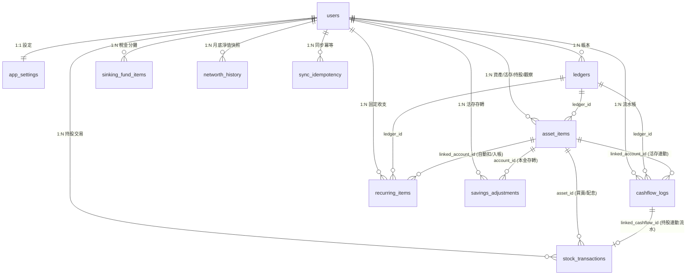
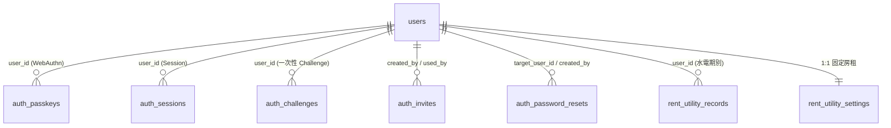
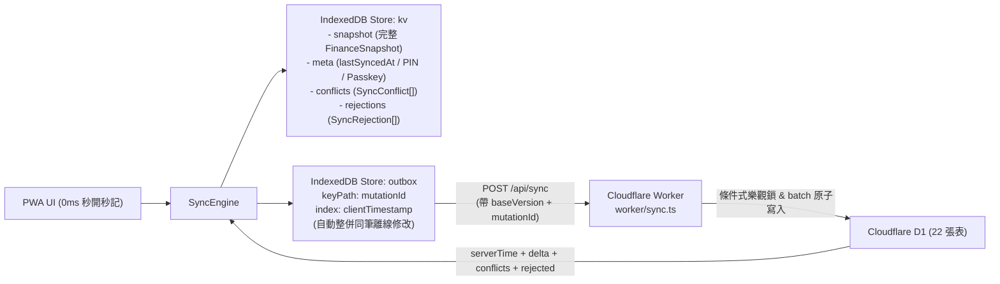

# 資料庫 Schema 設計架構（v1.8.3 / D1 Schema `0013`）

> **系統架構**：Cloudflare D1（SQLite）雲端主資料庫（21 張資料表）＋ 瀏覽器 IndexedDB 離線優先快取（`LocalFinanceDB`）  
> **最新 Migration**：[`0013_sync_cursor_epoch_and_auto_fx.sql`](../migrations/0013_sync_cursor_epoch_and_auto_fx.sql)  
> **對應版本**：`APP_VERSION = 1.8.3` / `DB_SCHEMA_VERSION = 0013` / `SW_CACHE_VERSION = finance-pwa-v23`

---

## 1. 核心架構原則

1. **多租戶引擎層隔離（Multi-Tenant Composite PK）**：
   - 所有業務資料表皆以 `user_id` 作為主鍵第一欄（`PRIMARY KEY (user_id, id)` 或 `PRIMARY KEY (user_id)`），搭配 `user_id` 前置索引，從儲存層確保家庭成員資料 100% 獨立隔離。
2. **多帳本隔離（Multi-Ledger Isolation，v1.7.0）**：
   - 以 `ledgers` 作為帳本主實體，內建不可刪除的 `default`（「個人主帳本」，`include_in_net_worth = 1`）。
   - `cashflow_logs`、`asset_items`、`recurring_items` 皆透過 `ledger_id` 歸屬帳本；`asset_items` 另提供 `exclude_from_net_worth` 單筆覆寫開關與 `is_watchlist` 觀察清單開關。
3. **離線優先同步與樂觀鎖（Offline-First + Optimistic Locking）**：
   - 支援離線編輯的業務表統一具備 `version`（伺服器遞增整數版號）、`updated_at`（增量同步游標）、`deleted_at`（Soft Delete Tombstone）。
   - 搭配 `sync_idempotency (user_id, mutation_id)` 保證重複重試不重複寫入。
4. **零明文安全憑證**：
   - 密碼與 PIN 皆採 PBKDF2 雜湊加鹽；Session Token、邀請碼與一次性重置碼在資料庫中僅保存 SHA-256 雜湊值。

---

## 2. 實體關聯圖（ER Diagram）

### 2.1 核心財務與多帳本領域（11 張表）

### 2.2 驗證、家庭管理與水電分攤領域（9 張表）

> 另包含兩張系統輔助／相容表：`auth_rate_limits`（IP 登入暴力破解限速）與 `auth_owner`（`0001` 單人時代遺留表，已於 `0007` 無痛遷移至 `users`）。

---

## 3. 完整 20 張 D1 資料表規格

### A. 核心財務與多帳本（9 張表）

#### 1. `app_settings`（個人全域設定）
- **主鍵**：`PRIMARY KEY (user_id)`
- **用途**：儲存每月預算、預備金目標月數、USD/TWD 匯率、正負配色方案與自訂持股分類。

| 欄位 | 型別 | 預設／約束 | 說明 |
| --- | --- | --- | --- |
| `user_id` | `TEXT` | `PK` | 使用者 ID |
| `monthly_daily_budget` | `INTEGER` | `NOT NULL DEFAULT 45000` | 個人主帳本每月日常消費預算（TWD） |
| `emergency_target_months` | `INTEGER` | `NOT NULL DEFAULT 6` | 緊急預備金目標月數 |
| `usd_twd_rate` | `REAL` | `NOT NULL DEFAULT 32.5` | 最新美元對台幣匯率 |
| `fx_updated_at` | `TEXT` | `NULL` | 匯率最後自動更新時間（ISO 8601） |
| `pnl_color_scheme` | `TEXT` | `NOT NULL DEFAULT 'intl'` | 配色方案：`intl` / `tw` / `tw_stocks`（`0008`） |
| `custom_stock_categories` | `TEXT` | `NOT NULL DEFAULT '[]'` | JSON 陣列，使用者自訂持股分類（`0009`） |
| `updated_at` | `TEXT` | `NOT NULL` | 最後更新時間 |
| `version` | `INTEGER` | `NOT NULL DEFAULT 1` | 樂觀鎖版號 |

---

#### 2. `ledgers`（多帳本主表，`0011` 新增）
- **主鍵**：`PRIMARY KEY (user_id, id)`
- **索引**：`idx_ledgers_user_updated (user_id, updated_at)`
- **用途**：定義個人主帳本（`id = 'default'`，不可刪除）與各獨立帳本（代管、公帳、副業、旅遊專戶等）。

| 欄位 | 型別 | 預設／約束 | 說明 |
| --- | --- | --- | --- |
| `user_id` | `TEXT` | `PK, DEFAULT 'owner'` | 所屬使用者 |
| `id` | `TEXT` | `PK` | 帳本 ID（預設主帳本為 `'default'`） |
| `name` | `TEXT` | `NOT NULL` | 帳本名稱（預設 `'個人主帳本'`） |
| `include_in_net_worth` | `INTEGER` | `NOT NULL DEFAULT 1` | `1`＝計入個人總資產／淨值與月底快照；`0`＝完全獨立隔離 |
| `monthly_daily_budget` | `INTEGER` | `NULL` | 選填獨立月預算；`NULL` 時顯示本月收支結餘 |
| `note` | `TEXT` | `NOT NULL DEFAULT ''` | 備註說明 |
| `sort_order` | `INTEGER` | `NOT NULL DEFAULT 0` | 顯示排序 |
| `created_at` / `updated_at` / `deleted_at` | `TEXT` | `NOT NULL` / `NULL` | 建立、更新與軟刪除時間 |
| `version` | `INTEGER` | `NOT NULL DEFAULT 1` | 樂觀鎖版號 |

---

#### 3. `cashflow_logs`（收支流水帳）
- **主鍵**：`PRIMARY KEY (user_id, id)`
- **索引**：
  - `idx_cashflow_user_ym (user_id, year_month, date DESC)`
  - `idx_cashflow_user_ledger_ym (user_id, ledger_id, year_month, date DESC)`（`0011`）
  - `idx_cashflow_user_updated (user_id, updated_at)`
  - `idx_cashflow_user_linked (user_id, linked_account_id)`
  - `idx_cashflow_recurring_dedup UNIQUE (user_id, recurring_dedup_key) WHERE recurring_dedup_key IS NOT NULL AND deleted_at IS NULL`

| 欄位 | 型別 | 預設／約束 | 說明 |
| --- | --- | --- | --- |
| `user_id`, `id` | `TEXT` | `PK` | 租戶與流水紀錄 UUID |
| `ledger_id` | `TEXT` | `NOT NULL DEFAULT 'default'` | 所屬帳本 ID（`0011`） |
| `date` | `TEXT` | `NOT NULL` | 交易日期（`YYYY-MM-DD`） |
| `year_month` | `TEXT` | `NOT NULL` | 所屬月份（`YYYY-MM`） |
| `type` | `TEXT` | `NOT NULL` | 類型（日常花費／固定支出／投資流出／薪資收入／其他收入／大額稅費支出） |
| `category` | `TEXT` | `NOT NULL` | 細項分類 |
| `item_name` | `TEXT` | `NOT NULL` | 品項名稱 |
| `amount` | `REAL` | `NOT NULL` | 原幣金額 |
| `currency` | `TEXT` | `NOT NULL DEFAULT 'TWD'` | 幣別（`TWD` / `USD`） |
| `fx_rate` | `REAL` | `NOT NULL DEFAULT 1` | 記帳當下換算匯率 |
| `twd_amount` | `INTEGER` | `NOT NULL` | 折合台幣整數金額 |
| `source` | `TEXT` | `NOT NULL DEFAULT '手機記帳'` | 來源標記（手機記帳／自動入帳） |
| `note` | `TEXT` | `NOT NULL DEFAULT ''` | 備註 |
| `recurring_dedup_key` | `TEXT` | `NULL` | 常態自動入帳冪等鍵（非預設帳本含 `${ledgerId}\|\|` 前綴） |
| `linked_account_id` | `TEXT` | `NULL` | 關聯的連動活存 `asset_items.id` |
| `created_at` / `updated_at` / `deleted_at` / `version` | `TEXT` / `INTEGER` | 標準同步欄位 | 軟刪除與樂觀鎖 |

---

#### 4. `asset_items`（資產、負債、活存、持股、貸款與觀察清單統一實體）
- **主鍵**：`PRIMARY KEY (user_id, id)`
- **索引**：
  - `idx_asset_user_updated (user_id, updated_at)`
  - `idx_asset_user_sort (user_id, sort_order, created_at)`（`0008`）
  - `idx_asset_user_ledger (user_id, ledger_id)`（`0011`）
- **設計說明**：透過特徵旗標（`is_linked_savings`、`is_amortizing_loan`、`is_watchlist`、`exclude_from_net_worth`）在同一張表支援五種資產型態，共用拖曳排序、自動行情排程與一鍵型態轉換（如觀察股 → 正式持股）。

| 欄位分組 | 欄位 | 型別 | 預設 | 說明 |
| --- | --- | --- | --- | --- |
| **識別與歸屬** | `user_id`, `id` | `TEXT` | `PK` | 租戶與資產 UUID |
| | `ledger_id` | `TEXT` | `'default'` | 所屬帳本 ID（`0011`） |
| | `exclude_from_net_worth` | `INTEGER` | `0` | `1`＝單筆排除不計入個人總資產（`0011`） |
| | `sort_order` | `INTEGER` | `0` | 手動拖曳排序順序（`0008`） |
| **基本分類與估值** | `update_mode` | `TEXT` | `'手動快照'` | `手動快照` / `自動更新` |
| | `major_type` | `TEXT` | `'資產'` | `資產` / `負債` |
| | `sub_category` | `TEXT` | `NOT NULL` | 活存、定存/現金、台股、美股/ETF、房貸等 |
| | `liquidity` | `TEXT` | `'中流動'` | 高流動／中流動／低流動／負債 |
| | `item_name` | `TEXT` | `NOT NULL` | 項目名稱 |
| | `quantity_or_amount` | `REAL` | `0` | 股數或基準原幣餘額 |
| | `currency` | `TEXT` | `'TWD'` | `TWD` / `USD` |
| | `unit_price` | `REAL` | `1` | 最新單價（非股票為 `1`） |
| | `note` | `TEXT` | `''` | 備註 |
| **股市行情與觀察清單** | `ticker` | `TEXT` | `''` | 股票代碼（如 `0050`、`VOO`、`NVDA`） |
| | `previous_close` | `REAL` | `NULL` | 前一交易日收盤價，用於計算今日漲跌與配色（`0010`） |
| | `price_updated_at` | `TEXT` | `NULL` | 股價最後自動更新時間 |
| | `cost_basis` | `REAL` | `NULL` | 期初總成本（原幣，`0004`） |
| | `stock_category` | `TEXT` | `''` | 持股分類：個股／ETF／特別股或自訂（`0009`） |
| | `is_watchlist` | `INTEGER` | `0` | `1`＝觀察清單（自動更價、嚴格排除總資產，`0010`） |
| **活存即時連動** | `is_linked_savings` | `INTEGER` | `0` | `1`＝連動活存帳戶（`0003`） |
| | `balance_anchor_date` | `TEXT` | `NULL` | 基準生效日（YYYY-MM-DD，亦供貸款使用） |
| | `balance_anchor_at` | `TEXT` | `NULL` | 基準精確時間戳（防止同日舊帳重複扣算） |
| | `is_default_savings` | `INTEGER` | `0` | `1`＝所屬帳本內預設連動活存（同 `ledger_id` 互斥） |
| **貸款本息均攤推算** | `is_amortizing_loan` | `INTEGER` | `0` | `1`＝啟用按月本息均攤推算（`0005`） |
| | `loan_annual_rate` | `REAL` | `NULL` | 貸款年利率（%） |
| | `loan_monthly_payment` | `REAL` | `NULL` | 每月固定月付金 |
| | `loan_billing_day` | `INTEGER` | `NULL` | 每月扣款日（1～31） |
| **同步欄位** | `created_at`, `updated_at`, `deleted_at`, `version` | `TEXT` / `INTEGER` | 標準 | 軟刪除與樂觀鎖 |

---

#### 5. `savings_adjustments`（活存本金存轉調整紀錄）
- **主鍵**：`PRIMARY KEY (user_id, id)`
- **索引**：`idx_savings_adj_user_account (user_id, account_id)`、`idx_savings_adj_user_updated (user_id, updated_at)`、`idx_savings_adj_user_transfer (user_id, transfer_group_id) WHERE transfer_group_id IS NOT NULL`（`0012`）
- **欄位**：`user_id`, `id`, `account_id`（對應 `asset_items.id`）, `date`, `amount`（正＝存入／負＝轉出）, `twd_amount`, `note`, `transfer_group_id`（配對互轉識別碼，`0012`）, `created_at`, `updated_at`, `deleted_at`, `version`。
- **用途**：記錄銀行間轉帳或本金移轉，更新活存即時餘額而不扭曲損益與儲蓄率；成對帳戶互轉透過 `transfer_group_id` 關聯以支援雙向一鍵撤銷。

---

#### 6. `stock_transactions`（持股買賣與配息／配股異動）
- **主鍵**：`PRIMARY KEY (user_id, id)`
- **索引**：`idx_stock_tx_user_asset (user_id, asset_id)`、`idx_stock_tx_user_updated (user_id, updated_at)`
- **欄位**：`user_id`, `id`, `asset_id`（對應 `asset_items.id`）, `date`, `tx_type`（`buy` / `sell` / `cash_dividend` / `stock_dividend`）, `shares`, `total_amount`, `fee`, `linked_cashflow_id`（選填對應 `cashflow_logs.id`）, `note`, `created_at`, `updated_at`, `deleted_at`, `version`。

---

#### 7. `recurring_items`（每月／定期固定收支規則）
- **主鍵**：`PRIMARY KEY (user_id, id)`
- **索引**：`idx_recurring_user_updated (user_id, updated_at)`、`idx_recurring_user_sort (user_id, sort_order, created_at)`、`idx_recurring_user_ledger (user_id, ledger_id)`
- **欄位**：`user_id`, `id`, `ledger_id`（`0011`）, `item_name`, `category`, `type`, `amount`, `currency`, `cycle`（月繳／年繳／特定月／一次性）, `billing_spec`, `status`（啟用／停用）, `linked_account_id`, `sort_order`, `note`, `created_at`, `updated_at`, `deleted_at`, `version`。

---

#### 8. `sinking_fund_items`（不定期稅金與大額攤提項目）
- **主鍵**：`PRIMARY KEY (user_id, id)`
- **索引**：`idx_sinking_user_updated (user_id, updated_at)`、`idx_sinking_user_sort (user_id, sort_order, created_at)`
- **欄位**：`user_id`, `id`, `item_name`, `category`, `total_amount`, `months`（預設 `12`）, `due_note`, `status`, `sort_order`, `note`, `created_at`, `updated_at`, `deleted_at`, `version`。

---

#### 9. `networth_history`（每月淨資產歷史快照）
- **主鍵**：`PRIMARY KEY (user_id, year_month)`
- **索引**：`idx_networth_user_updated (user_id, updated_at)`
- **欄位**：`user_id`, `year_month`, `snapshot_date`, `total_assets`, `total_liabilities`, `net_worth`, `high_liquidity_assets`, `investment_assets`, `insurance_assets`, `monthly_income`, `monthly_consumption`, `savings_rate`, `note`, `updated_at`。
- **口徑**：僅彙總 `isAssetIncludedInNetWorth === true`（排除觀察清單、獨立帳本與單筆排除項目）與 `include_in_net_worth = 1` 帳本的流水收支。

---

### B. 認證、安全與家庭多租戶（7 張表）

| 資料表 | 主鍵 | 核心欄位與索引 | 用途 |
| --- | --- | --- | --- |
| `users` | `id` | `username (UNIQUE NOCASE)`, `display_name`, `role ('admin'\|'member')`, `password_hash`, `password_salt`, `pin_enabled`, `pin_hash`, `pin_salt`, `show_utility_tab`, `is_active`, `created_at`, `updated_at`, `last_login_at` | 多租戶帳號主表（`0007`） |
| `auth_sessions` | `token_hash` | `user_id`（`idx_auth_sessions_user`）, `device_label`, `expires_at`, `created_at`, `last_seen_at` | 伺服器端登入 Session（SHA-256） |
| `auth_passkeys` | `credential_id` | `user_id`（`idx_auth_passkeys_user`）, `public_key`, `counter`, `transports`, `device_name`, `created_at` | WebAuthn / Face ID Passkey 憑證 |
| `auth_challenges` | `challenge` | `user_id`, `purpose`, `expires_at` | WebAuthn 5 分鐘一次性 Challenge |
| `auth_invites` | `id` | `code_hash (UNIQUE)`, `note`, `created_by`, `expires_at`, `used_by`, `used_at`, `revoked_at`, `created_at`（`idx_auth_invites_created`） | 家庭成員一次性邀請碼（`0007`） |
| `auth_password_resets` | `id` | `target_user_id`（`idx_auth_resets_target`）, `token_hash (UNIQUE)`, `created_by`, `expires_at`, `used_at`, `created_at` | 零知情管理員協助密碼重置碼（`0007`） |
| `auth_rate_limits` | `ip_key` | `fail_count`, `locked_until`, `updated_at` | 登入失敗次數與暫時鎖定（429 防護） |
| `auth_owner` | `id (CHECK id=1)` | `password_hash`, `password_salt`, `pin_*`, `updated_at` | `0001` 單人版遺留表（保留作升級相容） |

---

### C. 同步輔助與水電分攤工具（3 張表）

| 資料表 | 主鍵 | 核心欄位與索引 | 用途 |
| --- | --- | --- | --- |
| `sync_idempotency` | `(user_id, mutation_id)` | `applied_at` | 記錄已執行的離線 Mutation UUID，防止網路重試重複套用 |
| `rent_utility_records` | `(user_id, period)` | `is_baseline`, `cur_total`, `cur_6f`, `total_elec`, `total_water`, `f6_people`, `f5_people`, `cur_a`, `cur_b`, `cur_c`, `created_at`, `updated_at`, `deleted_at`, `version`（`idx_rent_utility_user_updated`） | 各期電表／水電費分攤紀錄（`0002`） |
| `rent_utility_settings` | `user_id` | `rent_6f`, `rent_a`, `rent_b`, `rent_c`, `updated_at`, `version` | 各房固定房租金額設定（`0002`） |

---

## 4. 用戶端離線資料庫架構（IndexedDB：`LocalFinanceDB`）

前端透過 [`LocalFinanceDB`](../web/src/db/localDb.ts) 在瀏覽器建立**按帳號隔離的獨立資料庫**（管理員為 `personal-finance-pwa-db`，其他成員為 `personal-finance-pwa-db:<userId>`），確保同裝置切換帳號不會看到彼此資料。

- **單一 Transaction 原子寫入與先存後改**：`commitLocalMutation()` 先於同一筆 IndexedDB 交易內原子持久化 `kv['snapshot']` 與 `outbox` 後才更新記憶體狀態；自動整併同一筆紀錄的離線編輯時會排除已送出等待回應的 in-flight 異動，並於 ack 後針對所有實體自動 rebase 最新 `version`。
- **衝突、拒絕、游標與 Epoch 保護**：伺服器以條件式 `UPDATE ... WHERE user_id = ? AND id = ? AND version = ?`（新建採 `INSERT ... ON CONFLICT DO NOTHING`）、`sync_idempotency` 與單調遞增 `user_sync_state.change_seq` 合併於同一 `db.batch()` 原子執行；`updated_at` 一律寫入伺服器時間（舊版無 `baseVersion` 客戶端改以 `sync_lww_timestamps` 維持 LWW 相容）；`replace` 覆蓋匯入會遞增 `data_epoch` 通知其他裝置完整重載；並支援 `X-Expected-User`（409 防跨帳號寫入）、`BroadcastChannel` 跨分頁帳號切換、Web Locks、分批同步（單批上限 50／伺服器上限 200）與逾時退避重試。

---

## 5. Migration 演進總覽（`0001` → `0013`）

| 版本 | 檔案 | 主要變更 |
| --- | --- | --- |
| `0001` | `0001_initial.sql` | 建立 12 張基礎表（設定、流水、固定收支、稅金攤提、資產、淨值歷史、驗證與冪等表） |
| `0002` | `0002_rent_utility.sql` | 新增 `rent_utility_records`、`rent_utility_settings` 水電分攤表 |
| `0003` | `0003_savings_linkage.sql` | 新增 `savings_adjustments`；擴充活存即時連動欄位與基準日防呆 |
| `0004` | `0004_stock_cost_basis.sql` | 新增 `stock_transactions` 與 `asset_items.cost_basis` 持股成本／配息追蹤 |
| `0005` | `0005_loan_amortization.sql` | `asset_items` 新增貸款本息均攤自動還本推算欄位 |
| `0006` | `0006_optimistic_versioning.sql` | 所有可同步資料表全面導入 `version` 樂觀鎖欄位 |
| `0007` | `0007_multi_tenant.sql` | 新增 `users`、`auth_invites`、`auth_password_resets`；重建 11 張業務表改為 `(user_id, ...)` 複合主鍵 |
| `0008` | `0008_sort_order_and_pnl_scheme.sql` | 新增 `pnl_color_scheme` 自訂正負配色與 `sort_order` 手動拖曳排序 |
| `0009` | `0009_stock_categories.sql` | 新增 `stock_category` 與 `custom_stock_categories` 持股自訂分類 |
| `0010` | `0010_watchlist_and_prev_close.sql` | `asset_items` 新增 `is_watchlist`（觀察清單）與 `previous_close`（昨收價） |
| `0011` | `0011_multi_ledger.sql` | 新增 `ledgers` 表並種子 `default` 主帳本；`cashflow_logs`、`asset_items`、`recurring_items` 全面加入 `ledger_id`，`asset_items` 加入 `exclude_from_net_worth` |
| `0012` | `0012_transfer_group.sql` | `savings_adjustments` 新增 `transfer_group_id` 欄位與局部索引，支援帳戶互轉雙向成對撤銷 |
| `0013` | `0013_sync_cursor_epoch_and_auto_fx.sql` | 新增 `user_sync_state`（單調 `change_seq` 與 `data_epoch`）與 `sync_lww_timestamps`；11 張可同步表加入 `change_seq` 與複合索引；`app_settings` 加入 `auto_fx_enabled`（排程自動匯率開關） |
