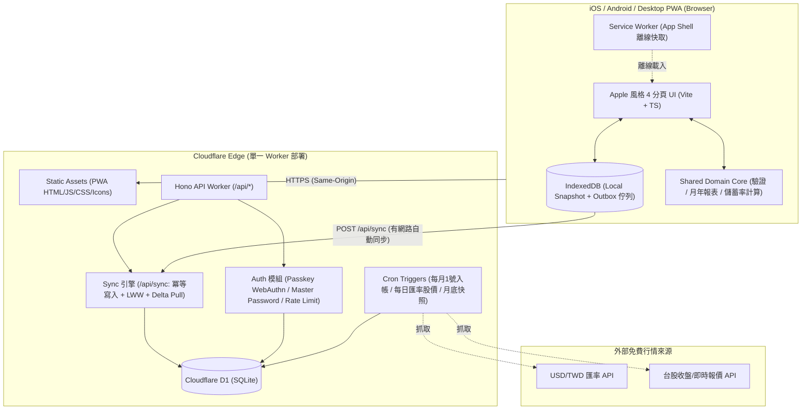
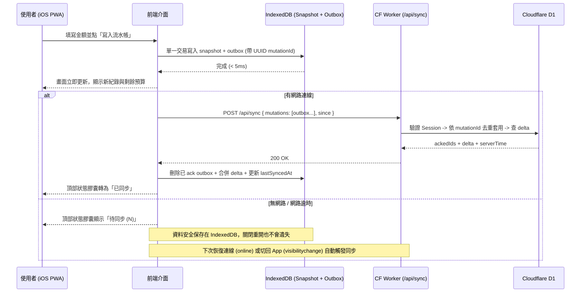

# Software Design Document (SDD)
## 個人現金流與資產負債管理系統 — Cloudflare 離線優先 PWA 版 (`cloudflare-pwa/`)

- **版本**：v1.0 (Draft for Review)
- **目錄位置**：`/home/antigravity/andyweij/personal-finance-gas/cloudflare-pwa/`
- **設計原則**：完整保留既有 GAS 系統（根目錄程式不動），於獨立子目錄建置次世代 **Local-First PWA + Cloudflare Workers + D1** 架構，達成 **0ms 離線記帳、iOS 主畫面原生體驗、單一平台免費維運、銀行級身份驗證**。

---

## 1. 背景與目標

### 1.1 解決的痛點
相較現行 GAS + Google Sheets 方案：
1. **效能瓶頸**：消除 GAS 冷啟動、iframe RPC 與試算表全表重算（2–5 秒 → 介面互動 **< 10ms**、雲端同步 **< 150ms**）。
2. **離線不可用**：支援完整 **Service Worker + IndexedDB**，於地下室、捷運或飛航模式下可秒開 App 記帳，連線後自動背景同步。
3. **跨裝置與安全性**：擺脫 GAS sandbox iframe 限制，在 iOS Standalone PWA 內支援 **Passkey（Face ID / Touch ID）+ 主密碼**、登入限速防暴力破解、閒置自動上鎖與金額隱私遮罩。
4. **零費用且不休眠**：全系統跑在 Cloudflare Free Plan（免綁信用卡、無 7 天閒置暫停問題）。

### 1.2 非目標（Out of Scope for v1）
- 多使用者／家庭共享帳本（v1 專注單一擁有者最高安全性與簡潔同步）。
- 銀行 API 自動對帳（台股與 USD/TWD 匯率支援自動抓取，銀行/基金/保單維持手動快照）。
- 自動雙向即時同步回 Google Sheets（改提供 **一鍵匯出 CSV / JSON 備份** 與 **從原 Google Sheets CSV 匯入遷移工具**）。

---

## 2. 系統架構總覽

### 2.1 部署與邏輯架構
採用 Cloudflare 單一部署模型（**Workers + Static Assets + D1 + Cron Triggers**），前後端同源（Same-Origin），徹底避開 CORS 問題並確保 iOS Safari `HttpOnly` Cookie 穩定運作。



### 2.2 專案目錄結構（獨立子目錄）

```text
personal-finance-gas/
├── src/                      # [不動] 既有 GAS TypeScript 原始碼
├── web/                      # [不動] 既有 GAS 前端
├── tests/                    # [不動] 既有 GAS 測試
└── cloudflare-pwa/           # [新增] 獨立 Cloudflare Offline-First PWA 專案
    ├── package.json
    ├── tsconfig.json
    ├── wrangler.toml.example # Cloudflare 部署範本（不含真實 DB ID）
    ├── vite.config.ts
    ├── vitest.config.ts
    ├── docs/
    │   └── SDD.md            # 本設計文件正式版
    ├── migrations/
    │   └── 0001_initial.sql  # D1 完整資料表與索引定義
    ├── shared/               # 前後端共用純 TypeScript 領域核心（零環境依賴）
    │   ├── constants.ts      # 類型、分類、週期、幣別、預設值（與原系統 100% 對齊）
    │   ├── types.ts          # Entity DTO、SyncMutation、API 型別定義
    │   ├── validation.ts     # 日期與各實體嚴格欄位驗證
    │   ├── calculations.ts   # 月/年指標、真實儲蓄率、12 月趨勢、資產配置、攤提計算
    │   ├── recurring.ts      # 週期規則判斷 (shouldPostRecurringItem) 與去重鍵
    │   └── csv.ts            # UTF-8 BOM CSV 匯出與原 GAS Sheets CSV 匯入解析器
    ├── worker/               # Cloudflare Worker 後端
    │   ├── index.ts          # Hono 路由入口 + scheduled() Cron 入口
    │   ├── db.ts             # D1 查詢/交易封裝
    │   ├── auth.ts           # PBKDF2 密碼、WebAuthn Passkey、Session Cookie、Rate Limit
    │   ├── sync.ts           # /api/sync 冪等套用 + 增量回傳引擎
    │   ├── automation.ts     # 每月常態自動入帳 + 月底淨資產快照
    │   └── market.ts         # USD/TWD 匯率與台股報價抓取（含備援與容錯）
    ├── web/                  # 前端 PWA
    │   ├── index.html
    │   ├── public/
    │   │   ├── manifest.webmanifest
    │   │   ├── sw.js         # Service Worker (App Shell Cache-First + API Network-Only)
    │   │   └── icons/        # iOS Apple Touch Icon & PWA Icons (SVG/PNG)
    │   └── src/
    │       ├── main.ts       # 啟動流程、事件綁定、閒置鎖定、同步觸發器
    │       ├── styles.css    # 延續 Apple 風格設計系統（深淺色模式 + Safe Area）
    │       ├── db/
    │       │   └── localDb.ts    # IndexedDB 封裝 (snapshot + outbox + meta)
    │       ├── sync/
    │       │   └── syncEngine.ts # 樂觀寫入、背景同步、401 保留佇列、狀態訂閱
    │       ├── auth/
    │       │   └── authClient.ts # 主密碼登入、Passkey (Face ID) 註冊/驗證、本機 PIN 鎖
    │       └── ui/               # 4 大分頁模組 + 彈窗 + 備份/遷移介面
    │           ├── logTab.ts
    │           ├── overviewTab.ts
    │           ├── configTab.ts
    │           ├── assetsTab.ts
    │           ├── modals.ts
    │           └── securityUi.ts
    └── tests/                # 單元與整合測試（於實作前先行撰寫）
        ├── domain.test.ts    # shared/ 計算、週期、驗證、CSV 遷移測試
        ├── sync-client.test.ts # IndexedDB 離線寫入、同步、斷網重試、401 保護測試
        ├── api.test.ts       # Worker Auth、Rate Limit、/api/sync、Automation、Market 測試
        └── pwa.test.ts       # Manifest、Service Worker 與建置產物完整性測試
```

---

## 3. 資料模型設計（Cloudflare D1 / SQLite）

為支援離線新增與多裝置同步，**所有業務主表皆採用客戶端產生的 `UUIDv4` 作為主鍵**（取代原本 Google Sheets 易受刪除位移影響的 `rowIndex`），並統一包含 `updated_at`（ISO-8601 UTC）與 `deleted_at`（軟刪除，供增量同步通知其他裝置移除資料）。

### 3.1 業務資料表

```sql
-- 1. 全域設定（單筆 id = 1）
CREATE TABLE app_settings (
  id INTEGER PRIMARY KEY CHECK (id = 1),
  monthly_daily_budget INTEGER NOT NULL DEFAULT 45000,
  emergency_target_months INTEGER NOT NULL DEFAULT 6,
  usd_twd_rate REAL NOT NULL DEFAULT 32.5,
  fx_updated_at TEXT,
  updated_at TEXT NOT NULL
);

-- 2. 收支流水帳（對應 CashFlow_Log）
CREATE TABLE cashflow_logs (
  id TEXT PRIMARY KEY,                    -- UUIDv4
  date TEXT NOT NULL,                     -- YYYY-MM-DD
  year_month TEXT NOT NULL,               -- YYYY-MM
  type TEXT NOT NULL,                     -- 固定收入|其他收入|固定支出|訂閱扣款|投資流出|日常花費|稅金與大額
  category TEXT NOT NULL,
  item_name TEXT NOT NULL,
  amount REAL NOT NULL,
  currency TEXT NOT NULL DEFAULT 'TWD',   -- TWD|USD
  fx_rate REAL NOT NULL DEFAULT 1,        -- 鎖定入帳當下匯率
  twd_amount INTEGER NOT NULL,            -- ROUND(amount * fx_rate)
  source TEXT NOT NULL DEFAULT '手機記帳', -- 自動入帳|手機記帳|手動輸入|匯入
  note TEXT NOT NULL DEFAULT '',
  recurring_dedup_key TEXT,               -- 僅自動入帳寫入: "YYYY-MM||type||itemName"
  created_at TEXT NOT NULL,
  updated_at TEXT NOT NULL,
  deleted_at TEXT
);
CREATE INDEX idx_cashflow_ym ON cashflow_logs(year_month, date DESC);
CREATE INDEX idx_cashflow_updated ON cashflow_logs(updated_at);
CREATE UNIQUE INDEX idx_cashflow_recurring_dedup
  ON cashflow_logs(recurring_dedup_key)
  WHERE recurring_dedup_key IS NOT NULL AND deleted_at IS NULL;

-- 3. 常態性與排程收支（對應 Recurring_Config）
CREATE TABLE recurring_items (
  id TEXT PRIMARY KEY,
  item_name TEXT NOT NULL,
  category TEXT NOT NULL,
  type TEXT NOT NULL,
  amount REAL NOT NULL,
  currency TEXT NOT NULL DEFAULT 'TWD',
  cycle TEXT NOT NULL DEFAULT '月繳',     -- 月繳|年繳|特定月份|一次性
  billing_spec TEXT NOT NULL DEFAULT '',  -- 如 "3,6,9,12" 或 "2026-12"
  status TEXT NOT NULL DEFAULT '啟用',    -- 啟用|停用
  note TEXT NOT NULL DEFAULT '',
  created_at TEXT NOT NULL,
  updated_at TEXT NOT NULL,
  deleted_at TEXT
);
CREATE INDEX idx_recurring_updated ON recurring_items(updated_at);

-- 4. 不定期稅金與大額攤提（對應 Annual_Sinking_Fund）
CREATE TABLE sinking_fund_items (
  id TEXT PRIMARY KEY,
  item_name TEXT NOT NULL,
  category TEXT NOT NULL,
  total_amount INTEGER NOT NULL,
  months INTEGER NOT NULL DEFAULT 12,
  due_note TEXT NOT NULL DEFAULT '',
  status TEXT NOT NULL DEFAULT '啟用',
  note TEXT NOT NULL DEFAULT '',
  created_at TEXT NOT NULL,
  updated_at TEXT NOT NULL,
  deleted_at TEXT
);
CREATE INDEX idx_sinking_updated ON sinking_fund_items(updated_at);

-- 5. 資產負債明細（對應 Assets_Liabilities）
CREATE TABLE asset_items (
  id TEXT PRIMARY KEY,
  update_mode TEXT NOT NULL DEFAULT '手動快照', -- 自動更新|手動快照
  major_type TEXT NOT NULL DEFAULT '資產',      -- 資產|負債
  sub_category TEXT NOT NULL,
  liquidity TEXT NOT NULL DEFAULT '中流動',     -- 高流動|中流動|低流動|負債
  item_name TEXT NOT NULL,
  ticker TEXT NOT NULL DEFAULT '',              -- 如 TPE:0050 或 0050.TW
  quantity_or_amount REAL NOT NULL DEFAULT 0,
  currency TEXT NOT NULL DEFAULT 'TWD',
  unit_price REAL NOT NULL DEFAULT 1,
  price_updated_at TEXT,
  note TEXT NOT NULL DEFAULT '',
  created_at TEXT NOT NULL,
  updated_at TEXT NOT NULL,
  deleted_at TEXT
);
CREATE INDEX idx_asset_updated ON asset_items(updated_at);

-- 6. 每月淨資產歷史快照（對應 NetWorth_History）
CREATE TABLE networth_history (
  year_month TEXT PRIMARY KEY,            -- YYYY-MM
  snapshot_date TEXT NOT NULL,            -- YYYY-MM-DD
  total_assets INTEGER NOT NULL,
  total_liabilities INTEGER NOT NULL,
  net_worth INTEGER NOT NULL,
  high_liquidity_assets INTEGER NOT NULL,
  investment_assets INTEGER NOT NULL,
  insurance_assets INTEGER NOT NULL,
  monthly_income INTEGER NOT NULL,
  monthly_consumption INTEGER NOT NULL,
  savings_rate REAL NOT NULL,             -- 0.0 ~ 1.0 (或負值)
  note TEXT NOT NULL DEFAULT '',
  updated_at TEXT NOT NULL
);
```

### 3.2 安全驗證與同步控制表

```sql
-- 7. 單一擁有者憑證（id = 1）
CREATE TABLE auth_owner (
  id INTEGER PRIMARY KEY CHECK (id = 1),
  password_hash TEXT NOT NULL,            -- PBKDF2-SHA256 hex
  password_salt TEXT NOT NULL,            -- 16-byte random hex
  pin_enabled INTEGER NOT NULL DEFAULT 0, -- 0|1 (App 介面快速鎖)
  pin_hash TEXT,
  pin_salt TEXT,
  updated_at TEXT NOT NULL
);

-- 8. WebAuthn Passkey (Face ID / Touch ID) 憑證
CREATE TABLE auth_passkeys (
  credential_id TEXT PRIMARY KEY,
  public_key TEXT NOT NULL,               -- base64url COSE public key
  counter INTEGER NOT NULL DEFAULT 0,
  transports TEXT NOT NULL DEFAULT '[]',
  device_name TEXT NOT NULL DEFAULT '',
  created_at TEXT NOT NULL
);

-- 9. 伺服器 Session（僅存 Token SHA-256 雜湊）
CREATE TABLE auth_sessions (
  token_hash TEXT PRIMARY KEY,
  device_label TEXT NOT NULL DEFAULT '',
  expires_at TEXT NOT NULL,
  created_at TEXT NOT NULL,
  last_seen_at TEXT NOT NULL
);

-- 10. WebAuthn 一次性 Challenge（5 分鐘過期）
CREATE TABLE auth_challenges (
  challenge TEXT PRIMARY KEY,
  purpose TEXT NOT NULL,                  -- register|authenticate
  expires_at TEXT NOT NULL
);

-- 11. 暴力破解防護限速表
CREATE TABLE auth_rate_limits (
  ip_key TEXT PRIMARY KEY,
  fail_count INTEGER NOT NULL DEFAULT 0,
  locked_until TEXT,
  updated_at TEXT NOT NULL
);

-- 12. 離線同步冪等紀錄（避免網路重試導致重複記帳）
CREATE TABLE sync_idempotency (
  mutation_id TEXT PRIMARY KEY,
  applied_at TEXT NOT NULL
);
```

---

## 4. 離線優先與同步引擎設計（Local-First Sync）

### 4.1 寫入與同步流程



### 4.2 同步協議規格 (`POST /api/sync`)
- **Request**：
  ```json
  {
    "since": "2026-11-23T08:00:00.000Z",
    "mutations": [
      {
        "mutationId": "c2f0c8c0-...",
        "entity": "cashflow",
        "op": "upsert",
        "recordId": "8a1b9e20-...",
        "clientTimestamp": "2026-11-23T08:05:12.100Z",
        "payload": {
          "date": "2026-11-23",
          "type": "日常花費",
          "category": "餐飲",
          "itemName": "午餐",
          "amount": 180,
          "currency": "TWD",
          "fxRate": 1,
          "source": "手機記帳",
          "note": "Apple Pay"
        }
      }
    ]
  }
  ```
- **衝突處理與冪等性**：
  1. **冪等防護**：伺服器檢查 `sync_idempotency`，若 `mutationId` 已處理過，直接列入 `ackedMutationIds` 略過執行。
  2. **衝突策略（Last-Write-Wins）**：單人多裝置情境下，若同一 `recordId` 雲端 `updated_at` 晚於 `clientTimestamp`，保留較新版本並於 `delta` 回傳給舊裝置覆寫。
  3. **軟刪除同步**：`op: "delete"` 設 `deleted_at = serverTime`、`updated_at = serverTime`，其他裝置在下次增量拉取時自動從本地移除。
  4. **認證過期保護（401 Handling）**：若離線多日後 Session 過期導致同步回 `401`，**絕對不清空 `outbox`**，而是提示重新驗證（Face ID / 主密碼），驗證完成立即接續上傳。

### 4.3 Service Worker 策略 (`web/public/sw.js`)
- **App Shell（`/`, `index.html`, JS/CSS bundle, icons, manifest）**：**Cache-First**（安裝時預快取，確保飛航模式也能秒開；新版部署時透過版本號快取名稱自動更新並在下次啟動生效）。
- **API 路由（`/api/*`）**：**Network-Only**（不經 Service Worker 快取，由前端 `syncEngine` 統一讀寫 IndexedDB，避免認證回應被錯誤快取）。

---

## 5. 安全性設計（對齊並超越原 GAS 驗證）

| 防護層級 | 機制設計 | 說明 |
| --- | --- | --- |
| **首次初始化保護** | `SETUP_SECRET` Worker Secret | 全新資料庫首次設定擁有者密碼時，必須帶入部署者於 Cloudflare Secret 設定的 `SETUP_SECRET`，防止陌生人搶先註冊。完成初始化後 `/api/auth/setup` 永久回傳 `403`。 |
| **主密碼驗證** | `PBKDF2-SHA256` (100,000 次迭代) + 16-byte 隨機 Salt + Constant-Time Compare | 使用 Cloudflare Workers 原生 Web Crypto API，絕不明文儲存密碼。 |
| **生物辨識登入** | **WebAuthn Passkey**（iPhone Face ID / Touch ID / Mac Touch ID） | 登入完成後可於「安全設定」一鍵綁定本機 Passkey，日後登入無需輸入主密碼且防釣魚。 |
| **防暴力破解** | D1 Rate Limiting | 同一來源 IP（`CF-Connecting-IP`）連續失敗 **5 次**即鎖定 **15 分鐘**並回傳 `429 Too Many Requests`。 |
| **Session 憑證** | `HttpOnly; Secure; SameSite=Strict` Cookie | 隨機 256-bit Token，資料庫僅存其 SHA-256 雜湊；30 天滑動效期，支援「登出目前裝置」與「登出所有裝置」。 |
| **本機防窺鎖** | 4～6 位數 App PIN 鎖 + 閒置自動上鎖（5/15/30/60 分）+ 一鍵金額遮罩 | **離線也能運作**：PIN 雜湊快取於本機，逾時自動清空畫面 DOM 並彈出鎖定畫面，解鎖免連網即可查看/記帳。 |
| **HTTP 安全標頭** | `CSP`, `X-Content-Type-Options: nosniff`, `X-Frame-Options: DENY`, `Referrer-Policy: no-referrer` | 防止 XSS、Clickjacking 與敏感 URL 外洩。 |

> [!NOTE]
> **忘記主密碼或 PIN 的復原機制**：部署者隨時可透過 `npx wrangler d1 execute` 執行單行 SQL 清除 `auth_owner`（或重設 `pin_enabled = 0`），完全不依賴第三方客服且帳本資料零遺失。

---

## 6. REST API 規格

所有 `/api/*`（除 `/api/auth/status`, `/api/auth/setup`, `/api/auth/login`, `/api/auth/passkey/login/*` 外）皆強制驗證有效 Session Cookie，未驗證一律回傳 `401`。

| 方法 | 路徑 | 用途 |
| --- | --- | --- |
| `GET` | `/api/auth/status` | 回傳 `{ initialized, authenticated, pinEnabled, passkeyCount }`（不洩漏財務資料） |
| `POST` | `/api/auth/setup` | 首次設定主密碼（需驗 `SETUP_SECRET`）並核發 Session Cookie |
| `POST` | `/api/auth/login` | 主密碼登入（含 Rate Limit） |
| `POST` | `/api/auth/logout` | 登出（支援 `?all=1` 撤銷全部裝置 Session） |
| `POST` | `/api/auth/passkey/register/options` | 取得 WebAuthn Passkey 註冊 Challenge |
| `POST` | `/api/auth/passkey/register/verify` | 驗證並儲存 Passkey 憑證 |
| `POST` | `/api/auth/passkey/login/options` | 取得 Passkey 登入 Challenge |
| `POST` | `/api/auth/passkey/login/verify` | 驗證 Passkey 簽章並核發 Session Cookie |
| `POST` | `/api/auth/pin` | 啟用 / 修改 / 關閉 4～6 位數 App PIN 鎖 |
| `POST` | `/api/sync` | 核心雙向同步（套用 `mutations` 並回傳增量或完整 `delta`） |
| `POST` | `/api/automation/recurring` | 手動觸發指定 `(year, month)` 常態收支自動入帳（冪等） |
| `POST` | `/api/automation/snapshot` | 手動觸發當月淨資產快照寫入 `networth_history` |
| `POST` | `/api/market/refresh` | 立即更新 USD/TWD 匯率與台股自動更新標的報價 |
| `GET` | `/api/export/json` | 下載完整帳本 JSON 備份 |
| `POST` | `/api/import/json` | 從 JSON 備份還原資料（支援合併或覆寫模式） |
| `POST` | `/api/import/csv` | 匯入原 Google Sheets 匯出的 CSV 分頁資料 |

---

## 7. 自動化排程與行情抓取設計

### 7.1 Cloudflare Cron Triggers（僅用 2 組，免費額度上限 5 組）
`wrangler.toml` 設定（Cloudflare Cron 使用 UTC，台灣時區為 UTC+8）：
1. **`0 0 1 * *`**（台灣時間 **每月 1 號 08:00**）：
   - 先更新最新 USD/TWD 匯率。
   - 執行 `runMonthlyRecurring(year, month)`：掃描 `recurring_items` 中 `status='啟用'` 且符合週期（`月繳` / `年繳` / `特定月份` / `一次性`）的項目寫入 `cashflow_logs`（鎖定當下匯率、防重複），並將已入帳的 `一次性` 項目自動轉為 `停用`。
2. **`0 15 * * *`**（台灣時間 **每日 23:00**）：
   - 更新 USD/TWD 匯率與 `asset_items` 中 `update_mode='自動更新'` 且具 `ticker` 的台股收盤價。
   - 判斷台灣時間明日是否為 1 號（精準支援 28/29/30/31 日）；若是月底，自動執行 `runMonthEndSnapshot()` 凍結純數值寫入 `networth_history`。

### 7.2 匯率與台股行情來源（免 API Key + 雙重備援）
- **USD/TWD 匯率**：
  - 主來源：`https://open.er-api.com/v6/latest/USD`（免費無需註冊）
  - 備援來源：Yahoo Finance Chart API (`TWD=X`)
  - 合理性檢查：`10 < rate < 100`，失敗則保留既有匯率不覆蓋。
- **台股股價（相容原格式 `TPE:0050` 與 `0050.TW`）**：
  - 正規化函式：`TPE:0050` → 代碼 `0050` / Yahoo 代號 `0050.TW`。
  - 主來源：台灣證交所公開資訊（TWSE `STOCK_DAY_AVG_ALL` / `mis.twse.com.tw`）
  - 備援來源：Yahoo Finance Chart API (`0050.TW`)
  - 失敗容錯：單一標的抓取失敗保留上次 `unit_price`，回報部分成功狀態而不中斷整體流程。

---

## 8. 前端 UI / UX 規格（完整延續 + 升級體驗）

保留原系統的 **Apple 風格 4 分頁設計**（淺/深色自適應、毛玻璃頂部/底部列、tabular-nums 等寬數字、桌面防誤觸置中彈窗 vs 手機 Bottom Sheet），並加入以下升級：

1. **頂部列新增「同步狀態膠囊」**：
   - `● 已同步`（綠色低調顯示）
   - `☁ 待同步 (N)`（琥珀色，點擊可手動立即重試）
   - `✈ 離線模式`（灰色，明確告知仍可照常記帳）
2. **4 分頁完整功能對齊**：
   - **Tab 1 記帳**：當月日常預算進度條 + 快速記帳表單（支援「設為每月固定自動入帳」同時寫入 2 筆離線 mutation）+ 流水帳明細（10 筆分頁列表模式 / 日曆檢視模式＋點擊日期補記）。
   - **Tab 2 總覽**：0ms 切換任意年份/月份（全量讀本機 IndexedDB，免等伺服器）、單月/全年度切換、4 大 KPI、投資與存款大項對照表、12 個月互動柱狀圖、預算與預備金參數設定。
   - **Tab 3 固定/分攤**：固定收支與訂閱篩選與開關（樂觀 0ms 切換）+ 立即入帳本月按鈕 + 不定期稅金攤提自訂月數。
   - **Tab 4 資產負債**：整合淨資產與負債比、iPhone 儲存空間風格資產配置長條（比例＋金額 / 僅比例 / 僅金額 3 模式切換 + 點擊高亮）、自動更新區（含「立即更新股價/匯率」按鈕）、手動快照區、近 12 個月淨資產歷史快照。
3. **安全與資料中心彈窗**：
   - 主密碼登入 / 首次初始化精靈
   - Passkey（Face ID / Touch ID）一鍵綁定與管理
   - 本機 App PIN 鎖與閒置自動上鎖設定（5 / 15 / 30 / 60 分 / 關閉）
   - **一鍵匯出 JSON / CSV 備份** 與 **從原 Google Sheets CSV 匯入遷移**

---

## 9. 測試計畫（Step 3 — TDD 先寫測試再開發）

於審查通過後，我們將先撰寫以下 4 組自動化測試（使用 `vitest`），確保所有邊界條件在開發前即被定義與驗證：

1. **`tests/domain.test.ts`（共用核心邏輯）**
   - 嚴格日期解析（含閏年、無效日如 `2026-02-30`）、金額/幣別/類型防呆
   - `shouldPostRecurringItem` 完整測試（`月繳`、`年繳`、`特定月份` 含中英文分隔符、`一次性` 留空/指定月/指定年月）
   - `aggregatePeriodMetrics` 單月（含攤提預備金）與全年度（採實際稅金大額）真實儲蓄率、緊急預備金月數、大項分類計算精準度
   - `computeMonthlyTrend` 12 個月結算與 `computeNetWorthSummary` 負債比與資產配置計算
   - CSV 匯出（含逗號/引號跳脫與 UTF-8 BOM）與原 GAS 試算表 CSV 匯入解析
2. **`tests/sync-client.test.ts`（離線優先與同步引擎）**
   - 離線新增/編輯/刪除：驗證立即反映於本地 snapshot 且正確排入 outbox
   - 連網同步：驗證 batch push + delta merge + 移除已 ack 項目
   - 冪等性與重試：模擬網路中斷重送相同 `mutationId` 不會產生重複紀錄
   - 401 Session 過期：驗證 outbox **完整保留不遺失**，且發送需重新驗證事件
   - LWW 衝突解決：雲端較新紀錄正確覆蓋舊本機狀態
3. **`tests/api.test.ts`（Worker API + D1 + Automation）**
   - 初始化流程：`SETUP_SECRET` 錯誤拒收、正確建立擁有者後無法重複 setup
   - Auth 安全：錯誤密碼 5 次觸發 `429` 鎖定、正確登入核發 `HttpOnly; SameSite=Strict` Cookie、登出後舊 Cookie 失效
   - `/api/sync` 端對端測試：批次 upsert/delete、重複 `mutationId` 冪等略過、`since` 增量回傳、未登入回 `401`
   - 自動化排程：`runMonthlyRecurring` 同月重跑防重複 + `一次性` 項目自動轉停用；`runMonthEndSnapshot` 精準寫入與同月覆蓋更新
   - 行情更新：mock 外部 API 成功、主來源失敗切換備援、全失敗時保留舊值不歸零
4. **`tests/pwa.test.ts`（PWA 離線資源完整性）**
   - 驗證 `manifest.webmanifest`（`display: "standalone"`, `start_url`, icons）與 `sw.js` 快取策略規則

---

## 10. 審查確認項目（請確認後進入 Step 3 寫測試）

在開始寫測試與程式前，請確認以下設計決策是否符合您的期待：

1. **獨立子目錄名稱**：使用 `cloudflare-pwa/`（或您偏好其他名稱，例如 `pwa/`、`app/`？）。
2. **驗證方式**：採用「**主密碼 + Passkey（Face ID / Touch ID）+ 本機選配 PIN 鎖**」（免綁卡、iOS PWA 零跳轉），是否符合預期？
3. **資料遷移**：是否需要支援直接匯入您目前 Google Sheets 匯出的 CSV（`CashFlow_Log` 等分頁）？目前 SDD 已納入。
4. **前端技術棧**：採用 **Vite + TypeScript（無重型框架、延續原 Apple UI 設計與極小打包體積）**，還是您希望用 React / Preact？
